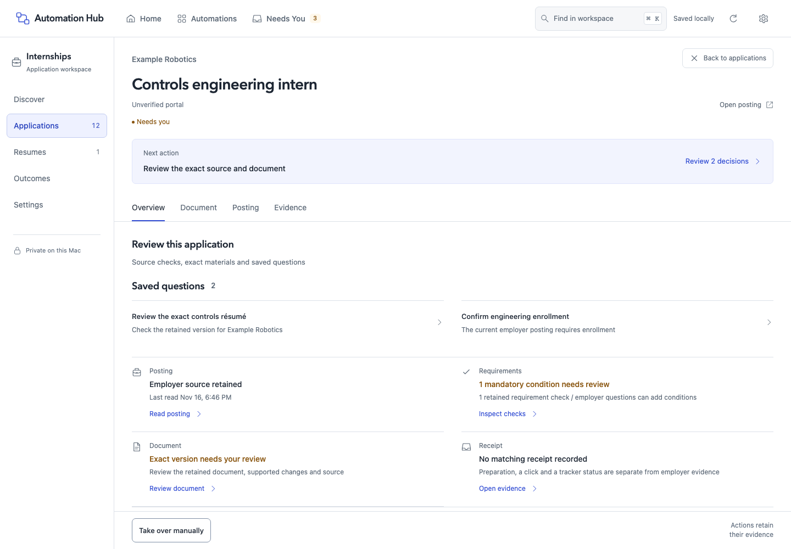
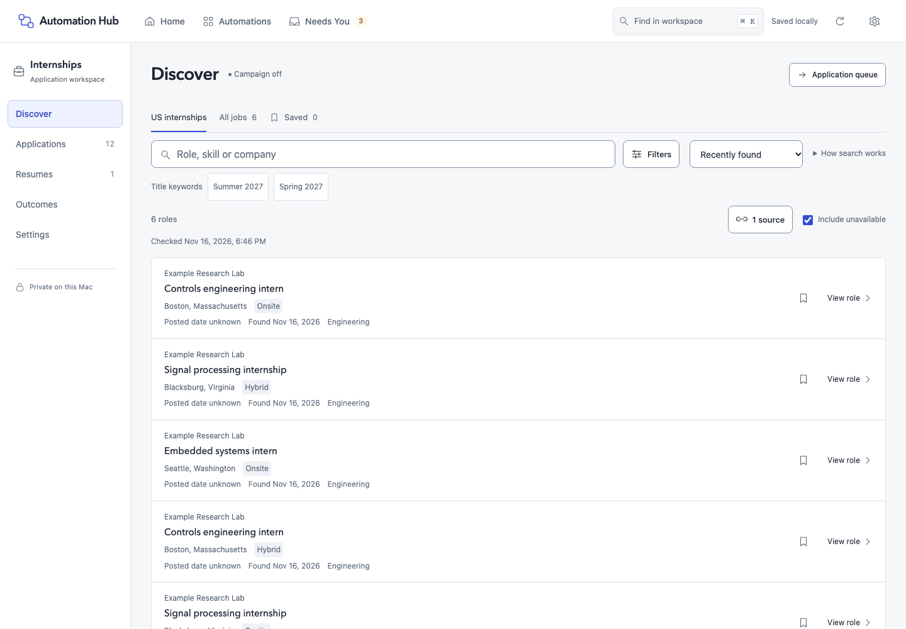
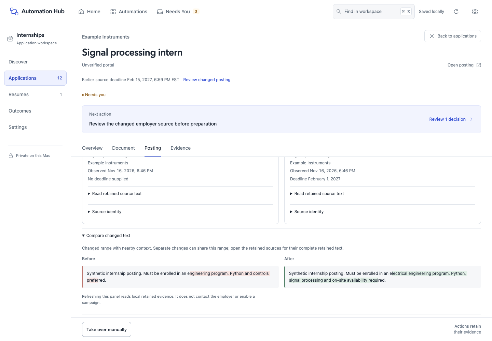

# Automation Hub

A local dashboard for personal automations, centered on finding and managing US internship applications, with an optional read-only view of existing n8n workflows.

The internship workspace connects employer-feed discovery, selected jobs, exact source versions, original resumes, scoped questions, reviewed documents and application evidence. Discover remembers the current search, filters, page and role as you review its queued application, with an explicit return route. The application overview puts exact pending questions, requirements, document readiness and receipt evidence in one place. Home puts each automation’s state, next useful action and saved questions together. Phone discovery groups its controls above the opportunity list. A native document chooser brings the selected retained preview into reach; prepared versions enter review before their existing guarded approval. A light workspace shell uses one global navigation and one contextual section list. Needs You pairs the saved-question list with one active question, and the document library puts retained originals and package versions beside a full preview. Find in workspace (Command-K or Control-K) opens pages, exact saved applications and questions. Local reasoning activity, full per-application history and on-demand worker status make saved work easier to inspect and recover. n8n remains responsible for its own execution and schedules.

This is an early macOS-first project. It is intended for one person on their own computer. Supported employer adapters currently cover Greenhouse and Lever, with local fixtures for their supported paths. Employer customizations and other portals need separate validation. A prepared document or a synthetic receipt does not establish a real submission or a hiring outcome.



Application review with isolated synthetic data. [Home](docs/images/home.png), [phone queue](docs/images/applications-phone.png) and [phone Home](docs/images/home-phone.png).

## Run from source

Use Node.js 24.14 or newer. Install the locked dependencies, browser engines and production UI:

```sh
npm ci --ignore-scripts
npm run browser:install
npm run build
npm start
```

The launcher opens an authenticated browser session on `127.0.0.1:4317`. Keep its terminal open; Ctrl+C stops the source-launched server. On macOS, `Start Hub.command` is an alternative after the first setup.

DOCX preview and rendering require LibreOffice. Install it through its official distribution and point `HUB_SOFFICE_BIN` to its `soffice` executable if it is outside your PATH. PDF, Markdown and plain-text imports remain available without a DOCX renderer. The project does not download a renderer automatically.

Private data defaults to `~/Library/Application Support/Automation Hub`, outside the checkout. An absolute `HUB_DATA_DIR` selects a different private directory. The application requires an owned directory with private permissions. See [operation and recovery](docs/OPERATIONS.md).

## Use the workspace

Home shows actual automation work, current questions and direct Discover, Applications and Résumés destinations. The optional “How this automation works” guide explains the five stages. Inside the internship workspace, a contextual section list becomes a native section picker on phones. Linked n8n workflows show only observed stages and status.

1. Explore the separate fixture workspace in Internships → Settings before entering real data.
2. Import finished resumes and selected HTTPS job links. An optional mega resume supplies supporting evidence and cannot be the uploaded base.
3. Confirm candidate facts and allowed sites, then review documents and any missing answers.
4. Configure optional connections explicitly. The application starts without a real campaign enabled.
5. Enable a concrete campaign only after reviewing its inputs and rules. Unknown consent, unsupported forms, account challenges and missing facts remain visible exceptions.

**Discover US internships:** in Discover, add a public employer board with **Add source**, then choose **Check jobs** to read its openings. Adding the source saves its configuration locally. Browsing and saving need no resume, AI connection, employer account or enabled campaign. Discovery reads supported Greenhouse, Lever and Ashby employer boards. Ashby uses its public Posting API; its applications require manual completion, with no Ashby auto-apply adapter claimed. Feed links can lead to custom application portals; actual employer forms still require verification.

Discover opens on the **US internships** preset, combining an internship keyword check with employer-supplied US location evidence. **All jobs** shows the broader retained observations, and **Review uncertain locations** keeps unknown or conflicting geography accessible. A board's technical host region does not establish where a job is based.

Search and filters apply across the full retained result set, with pages of 40 matching roles. Keyword filters use supplied text and do not establish degree fit or eligibility. Large boards may supply titles and locations without descriptions; the source and role views disclose this reduced coverage. Read the employer posting for full requirements.

The Summer 2027 and Spring 2027 shortcuts search employer text for those words. They do not establish a hiring cycle, dates or eligibility.



US internship browsing with isolated synthetic data.

Posted dates appear only when supplied by the employer. Ashby’s Last published timestamp stays distinct from an original posting date. **Found** records the first local observation, and the detail view keeps the latest successful observation. Partial, stale and failed checks retain previous roles with their dated or unknown status. Saved roles survive a disconnected or unavailable source. Use **Check jobs** when you want a new bounded observation.

| State | Meaning |
| --- | --- |
| Saved | A local shortlist bookmark |
| In application queue | A role explicitly selected for preparation under campaign rules |
| Confirmed | An application with matching employer evidence in the application ledger |

Needs You opens one exact employer question while retaining other current answer drafts. The Résumés library distinguishes finished originals, supporting evidence and prepared versions. Missing or stale review evidence offers recovery. Connections and workflow linking have one owning Connections page.

The application queue has counted work views, multiword role/employer search, stable sorting and pages of 40. Known-deadline sorting leaves missing or uncertain dates below established dates. Opening a search result reveals its exact page. Application review uses the full workspace; Back returns to the same queue, filters, sort and row focus. The phone layout keeps Back, review tabs and actions reachable while long role content scrolls.

The inspector's **Overview** shows exact saved questions first, then source, requirements, document and receipt checks. Checks describe retained evidence rather than an invented progress percentage. Candidate attestation, employer requirement text and a matching receipt remain different kinds of evidence.

**Posting** compares the source used to prepare a document with the latest retained observation, including literal changed text and separate adapter/content hashes. A changed source is retained before the application is held. Failed preparation cannot make an older document current for a new posting. New packages bind to the exact retained posting and candidate revision; older unbound packages remain previewable and require fresh preparation before approval or use. Choosing a finished original can queue a public posting read and prepare it without model reasoning or campaign enablement.



Adding a fresh role to the queue does not itself submit an application. Dispatch follows the enabled campaign rules and required document/question review.

Unreadable or lost save replies show an unknown outcome and require reconnecting to inspect saved work before retrying. A late completion cannot close a newer editing session or clear its input. Unexpected view failures offer a focused local recovery surface without replaying application actions.

Résumé reasoning clarifications are bound to the saved candidate, posting, exact question and usable source corpus. Changed or unbound earlier answers need renewed review; they are not silently reused. Saved deadlines remain dated evidence. A changed source labels its earlier deadline and holds document use until the source is reviewed.

Original documents remain available. Edited documents and written answers require the appropriate exact-content review. The app tracks prepared, dispatched, uncertain and confirmed states separately; uncertain external effects cannot be blindly retried.

Needs You retains unsaved answer text and choices as you move between views during the open UI session, while their workspace, question, posting, profile and document context still match. Context changes invalidate that draft binding, and switching between real and fixture workspaces clears the cache. Reloading closes this temporary memory; explicitly save answers and review the exact writing before relying on them.

The browser adapter handles native controls and a narrow observed Greenhouse static single-choice widget. A custom choice must expose its exact question, owning form, unique owned listbox, enabled options and selected readback. Unknown wrappers, interactive option elements, search/geocoder, asynchronous, creatable and multichoice controls remain manual. Local fixtures do not establish live compatibility with every employer form.

Optional reasoning uses an existing Codex CLI ChatGPT sign-in and your selected model preferences. It must be explicitly enabled and has a saved call limit. This adapter rejects API-key and unknown sign-in modes. No key is included in this repository. Existing account limits and terms still apply. You can select finished resumes manually without enabling reasoning.

Optional Gmail observation uses your own Google OAuth Desktop client with read-only consent. Employer accounts and optional service secrets belong in the app-owned encrypted vault. The hub does not send Gmail messages. Optional n8n observation reads selected workflow metadata; it does not activate or execute workflows. Connection setup stays local and is never needed for the test suite.

## Check a change

On macOS, install Xcode command-line tools and LibreOffice, then run:

```sh
export HUB_SOFFICE_BIN="/Applications/LibreOffice.app/Contents/MacOS/soffice"
npm run check
```

Checks use synthetic candidate, employer, mailbox and provider fixtures. They include Node tests, a production build and Chromium/Firefox UI tests. Native filesystem checks compile Swift on macOS. The CI workflow uses a macOS runner without paid model APIs or real accounts. CI results, local checks and real employer acceptance are separate evidence.

Linux and Windows are not certified platforms. The native shell and packaging are macOS-only.

## Build the Mac shell

After `npm run build`, `npm run app:build` builds an app for the current Mac architecture into `~/Applications/Automation Hub.app`. `npm run app:open` opens it. The build needs Xcode command-line tools and a self-contained official Node.js binary distribution. Node's complete LICENSE must be at the distribution root above `bin/node`, or set `HUB_NODE_LICENSE` to its absolute regular file path. The build checks and captures that file before creating app outputs; it never downloads or substitutes a license. Custom Node installations that depend on external libraries are not supported for a portable native bundle.

The app is locally ad-hoc signed, not notarized. It bundles Node and production dependencies; browser binaries, LibreOffice and optional Codex remain external local tools. This repository distributes source, without prebuilt native binaries.

Closing or quitting the native window leaves its user-started background worker running. Pause or stop campaigns in the workspace when needed. It does not install a login item or system daemon. Build receipts and generated machine paths are local outputs and must not be committed.

The native opening panel waits for both the current primary navigation and the current React workspace commit. If that display does not become ready or its process stops, the app shows recovery with **Reconnect** and **Open in Browser**. Reconnect is explicit and reopens saved progress; the display timeout does not reload the page or replay application actions automatically. These display signals do not certify backend connections or application success.

## Pause, quit and shut down

Campaign **Pause/Stop** changes application work. Native **Quit** closes the window and leaves its worker running. For maintenance, choose **Automation Hub → Shut Down Background Worker…** and confirm. The app reports verified shutdown only after the identified process exits and its private control entries are gone. Reconnect is explicit; stopping the display never replays a submission.

Source users can run `npm run service:stop` with the same absolute `HUB_DATA_DIR`. This command never starts a worker, signals a process or removes unknown control files. A refusal or timeout is not proof that restoration is safe. See [complete recovery instructions](docs/OPERATIONS.md).

Explicit `HUB_CODEX_BIN`, `HUB_SOFFICE_BIN` and `PLAYWRIGHT_BROWSERS_PATH` values take precedence over captured configuration. Native builds retain these local paths for launches without a shell environment. Invalid explicit settings do not silently select another tool. Optional tools are checked when used; browsing does not require every connection.

## Project map

| Path | Purpose |
| --- | --- |
| `web/` | React interface and workspace state |
| `server/` | Local API, durable state, document and application services |
| `native/` | macOS window, previews and completed-download saving |
| `scripts/` | Launch, build and dependency-notice helpers |
| `tests/` | Synthetic service, document, browser and native fixtures |

See [architecture](docs/ARCHITECTURE.md), [contributing](CONTRIBUTING.md) and [security reporting](SECURITY.md). Original project code is under the [MIT license](LICENSE). Dependencies retain their own licenses; the build generates third-party notices from their installed license files. No upstream application runtime or research corpus is distributed here.

[Research and design decisions](docs/PRODUCT_DECISIONS.md) explain the implemented patterns and remaining coverage limits.
