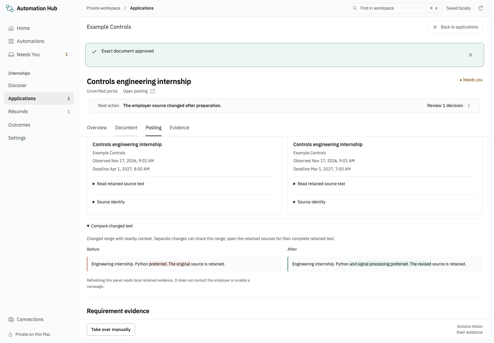
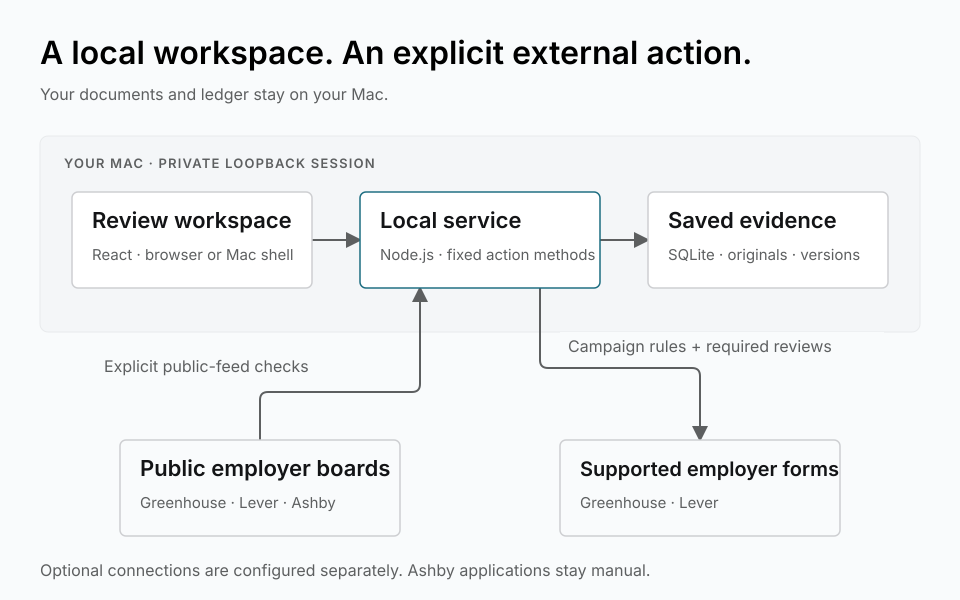

# Automation Hub

**A local internship application workbench for macOS.** Save roles, review résumés and employer questions, and see which posting a prepared document used.

## The posting changed. The PDF didn’t.

In this synthetic run, the posting changed its preferred skills and deadline. The old review returned **409 / posting_changed**. A fresh review approved the same PDF bytes against the updated posting. The campaign stayed off, with zero model calls or submissions.

[Inspect the two posting records and PDF](docs/presentation/README.md) · [Download the offline reader](https://raw.githubusercontent.com/nazeeh111/automation-hub/f3cab2df853056b68c1b2c5d209b0b2c97d49d0b/docs/presentation/retained-review.zip)

<picture><source media="(max-width: 600px)" srcset="docs/presentation/posting-phone.png"></picture>

The screenshot shows the running app in an isolated workspace with fictional data and a local employer fixture. [Run locally](#run-locally) · [Take the fixture tour](docs/DEMO.md)

## One role. Its whole story.

A promising opening becomes a saved role. A selected role gets a document, questions and a history. When the employer changes the posting, the earlier source and prepared file remain available for comparison. When a submission outcome is uncertain, that uncertainty remains visible.

1. **Discover.** Read public Greenhouse, Lever and Ashby employer boards. Search retained openings, check US location evidence and save a shortlist without a résumé, account connection or enabled campaign.
2. **Prepare.** Choose a finished résumé or explicitly enable optional reasoning. Keep originals and inspect the exact prepared document alongside the posting it uses.
3. **Review.** Resolve the employer's specific questions, check requirements and approve the actual document. Missing facts, changed sources and unfamiliar controls become explicit review work.
4. **Track.** Keep preparation, dispatch, uncertain outcomes and matching employer evidence separate. Return to the exact application when a question or source needs another look.

Saving a role does not submit an application. Campaigns start off; application work follows the campaign rules and required reviews.

## What makes the workspace useful

**A posting has a history.** Compare the source used for a document with the latest retained observation, including changed text. A newer posting holds use of an older package until the current source and document are reviewed. Failed preparation preserves the earlier file.

**The question stays with the application.** Needs You opens the exact saved employer question. Answers and writing reviews belong to the current candidate, posting and document context. Changed context requires renewed review. Current unsaved answers survive navigation within the same UI session.

**The original stays an original.** The document library keeps finished résumés, supporting evidence and prepared versions distinct, with full previews. Choosing an existing finished résumé does not require model reasoning.

**Progress has evidence.** Application review brings source, requirements, document readiness and receipt checks together. Its history records what happened; an unknown external outcome requires reconciliation before another attempt.

See the [guided fixture tour](docs/DEMO.md) for a reproducible walkthrough and the [design decisions](docs/PRODUCT_DECISIONS.md) for the implementation rationale.

## Run locally

Use **macOS and Node.js 24.14 or newer**. Clone the source, install the locked dependencies and browser engines, then build and start:

```sh
git clone https://github.com/nazeeh111/automation-hub.git
cd automation-hub
npm ci --ignore-scripts
npm run browser:install
npm run build
npm start
```

The launcher opens a private authenticated browser session on `127.0.0.1:4317`. Keep its terminal open; **Ctrl+C** stops a source-launched server. `Start Hub.command` is an alternative after setup.

Start with **Internships → Settings → Open fixture workspace**. Synthetic candidates, employer forms and receipts stay separate from real applications. Follow the [tour](docs/DEMO.md) before entering personal data.

**Document rendering.** DOCX preview and rendering require [LibreOffice](https://www.libreoffice.org/download/download-libreoffice/). PDF, Markdown and plain-text imports remain available without it. For the usual macOS installation:

```sh
export HUB_SOFFICE_BIN="/Applications/LibreOffice.app/Contents/MacOS/soffice"
```

Set this before starting the app if `soffice` is not on your PATH. The project does not download a renderer automatically.

**Private storage.** Data defaults to `~/Library/Application Support/Automation Hub`, outside the checkout. An absolute `HUB_DATA_DIR` selects another private, user-owned directory. Backups, restore requirements and tool-path configuration are documented in [operation and recovery](docs/OPERATIONS.md).

## Current scope

This is an early, single-person, macOS-first project. It ships source and a locally buildable Mac shell.

| Area | Supported scope |
| --- | --- |
| Discovery | Public Greenhouse, Lever and Ashby employer boards; manually requested checks |
| Application adapters | Bounded Greenhouse and Lever form paths, exercised with local fixtures; employer customizations need separate validation |
| Ashby applications | Manual completion; discovery support does not imply submission support |
| Geography and dates | Employer-supplied evidence; ambiguous locations and missing dates remain visible |
| Documents | Original retention, previews and source-bound prepared packages; LibreOffice required for DOCX rendering |
| Platforms | macOS; Linux and Windows are not certified |

Search and season shortcuts match available employer text. They do not establish eligibility or a hiring cycle. Partial feeds can omit descriptions; stale and failed checks retain earlier observations with their status. Read the full employer posting before deciding.

Unsupported controls, account challenges, uncertain consent and missing facts remain manual or require review. Local fixtures do not establish compatibility with every live employer. A prepared file, synthetic receipt or passing test suite does not establish a real submission or hiring outcome.

## Optional connections

The workspace runs without these connections:

| Connection | What it adds |
| --- | --- |
| Codex CLI | Explicitly enabled résumé reasoning using an existing ChatGPT sign-in, selected model preferences and a saved call limit. API-key and unknown sign-in modes are rejected. Existing account limits and terms apply. |
| Gmail | Read-only observation with your own Google OAuth Desktop client and consent. The hub does not send Gmail messages. |
| n8n | Read-only status and metadata for selected workflows. n8n keeps execution and schedule ownership. |

Employer sessions and optional service secrets belong in the app-owned encrypted vault. Configure only the connections needed for the work you choose.

## How it fits together



React supplies the review workspace. A loopback Node.js service owns sessions, the SQLite ledger, retained documents and fixed preparation/application methods. Playwright handles supported browser paths. The optional Swift/WebKit shell opens the same local workspace.

State and review checks live in the service. A model cannot direct a general-purpose tool executor. Dispatch intent is recorded before an external action; unresolved external outcomes remain held for reconciliation.

| Code | Responsibility |
| --- | --- |
| [`web/`](web/) | Workspace, discovery, application review and document previews |
| [`server/`](server/) | Local API, durable ledger, documents, adapters and action checks |
| [`native/`](native/) | Mac shell, launch recovery and completed-download saving |
| [`tests/`](tests/) | Isolated service, document, employer-form and browser fixtures |

Read the [architecture](docs/ARCHITECTURE.md) for source bindings, transaction boundaries and recovery behavior.

## Verify a change

Install Xcode command-line tools and LibreOffice on macOS, complete the source setup above, then run:

```sh
export HUB_SOFFICE_BIN="/Applications/LibreOffice.app/Contents/MacOS/soffice"
npm run check
```

The check runs Node service tests, a production build and Chromium/Firefox UI tests. Native filesystem checks compile Swift on macOS. Synthetic candidates, employer pages, mailboxes and provider responses keep the suite independent of real accounts and paid model calls. [GitHub Actions](https://github.com/nazeeh111/automation-hub/actions/workflows/check.yml) runs fixture checks on macOS.

## Use the Mac shell

After a production build:

```sh
npm run app:build
npm run app:open
```

This creates `~/Applications/Automation Hub.app` for the current Mac architecture. The build requires Xcode command-line tools and a self-contained official Node.js distribution with its complete root `LICENSE`; `HUB_NODE_LICENSE` can point to that regular file. The app is locally ad-hoc signed and is not notarized. No prebuilt binaries are published. Browser engines, LibreOffice and optional Codex stay external.

Closing the native window or choosing **Quit** leaves its user-started worker running. Use campaign **Pause/Stop** to change application work. For maintenance, use **Automation Hub → Shut Down Background Worker…** or `npm run service:stop` with the same data directory. No login item or system daemon is installed. Follow the [shutdown and restore instructions](docs/OPERATIONS.md) before restoring private data.

## Contribute

See [CONTRIBUTING.md](CONTRIBUTING.md) for development and reporting guidance, and [SECURITY.md](SECURITY.md) for private vulnerability reporting.

Original project code is [MIT licensed](LICENSE). Dependencies retain their own licenses; builds generate third-party notices from installed license files. No upstream application runtime or research corpus is distributed here.
