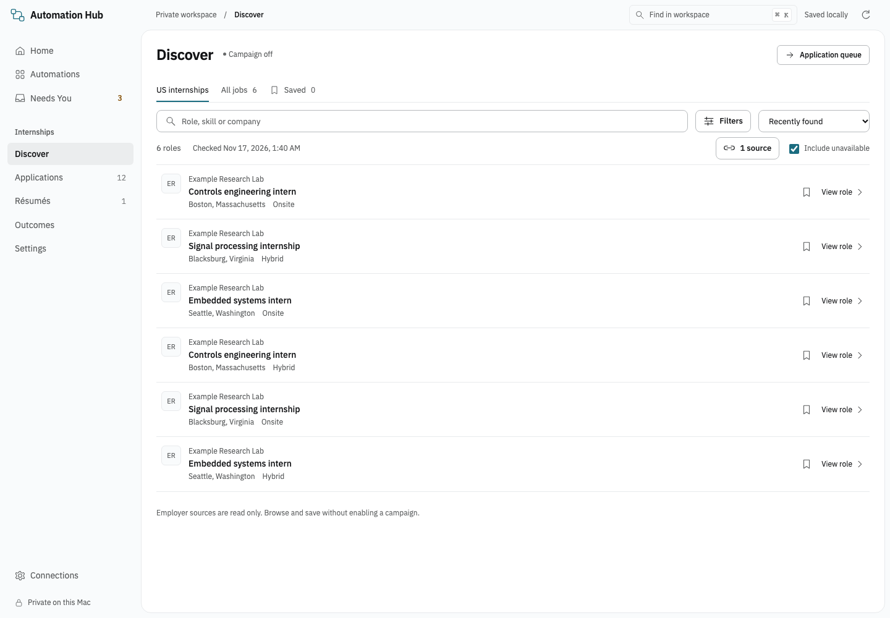
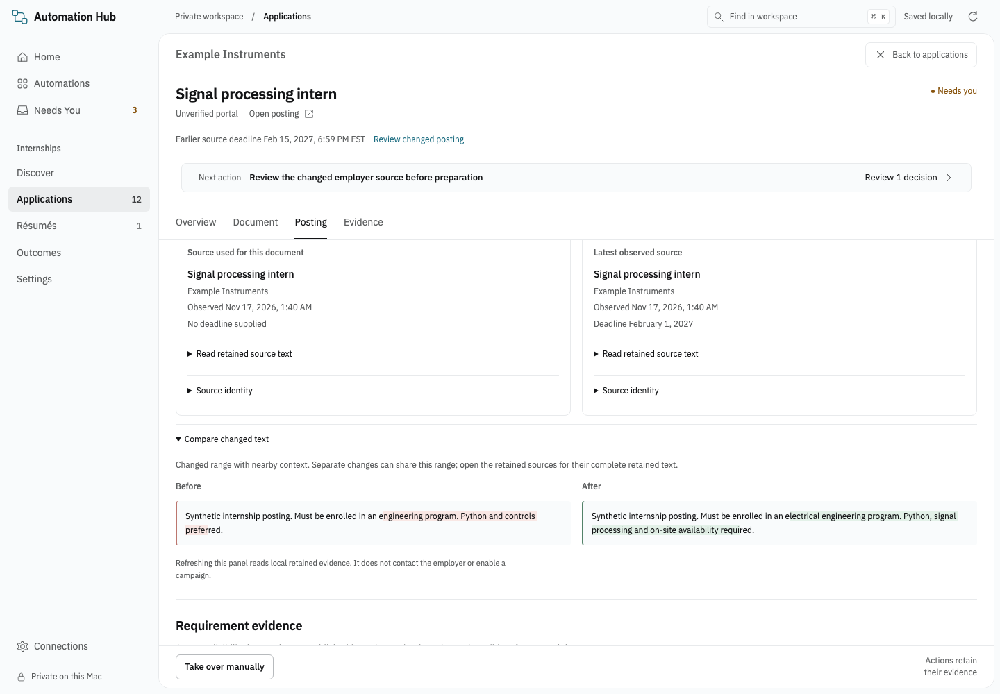
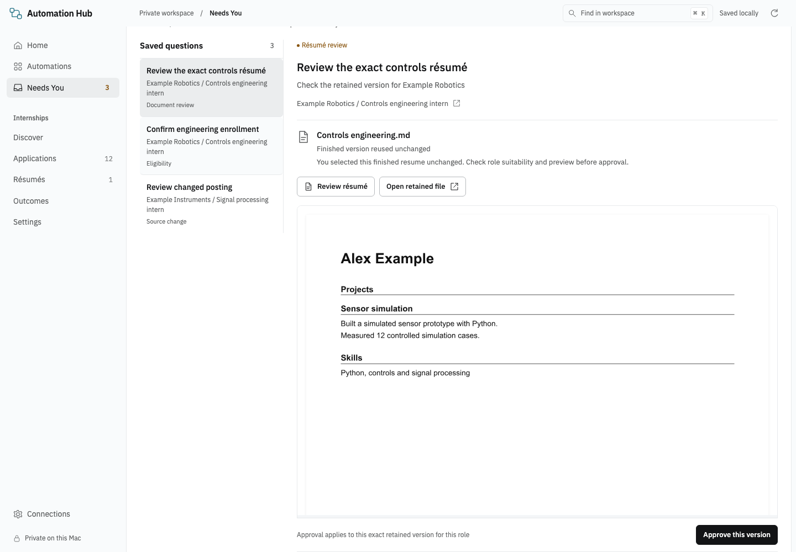

# A role through the workspace

This tour uses Automation Hub's isolated fixture workspace. Candidates, employers, résumés, questions and receipts in the demonstration are synthetic. They illustrate retained software state and do not represent live applications, employer acceptance or hiring results.

Screenshots show curated fixtures captured from the running application, including prepared documents and source changes. They are richer than the fresh built-in fixture seed described below. No live application or hiring outcome is shown.

The short route: **Applications → document review → Résumés → application history**, with Discover and Needs You available as work arrives. Keep the campaign off throughout this tour.

## 1. Open the fixture workspace

Complete the [source setup](../README.md#run-locally), start the app, then open **Internships → Settings → Open fixture workspace**. Confirm that the workspace identifies itself as a fixture before making changes. Fixture data is stored separately from your real workspace.

On first use, the built-in fixture supplies Alex Example, an example Markdown résumé and two selected roles: **Engineering intern / Example Labs** and **Question internship / Example Robotics**. It does not prefill discovery feeds, pending questions, prepared files or receipts. Those depend on retained actions. Existing fixture work is preserved when you reopen it.

Home shows current work, saved questions and each automation's next useful action. **Command-K** or **Control-K** finds pages, retained applications and questions. It navigates to the exact saved record.

## 2. Explore discovery

Open **Discover**. The **US internships** preset uses an internship keyword check and employer-supplied US location evidence. **All jobs** includes broader retained observations, and **Review uncertain locations** keeps ambiguous geography accessible.

A fresh fixture workspace can have no discovery sources. That is expected. The two built-in example roles are already in **Applications**, so continue there for the local document tour. When discoveries are present, inspect the employer, location, source status and date evidence. A saved role is a bookmark. **Add to application queue** explicitly selects a fresh role for preparation; it does not enable a campaign or submit a form.

Search covers the full retained result set before pagination. Summer/Spring shortcuts are text queries, not eligibility or hiring-cycle checks. A board can provide titles and locations without descriptions. Read the original posting when that coverage is incomplete.

To try real public browsing later, return to the real workspace, use **Add source** for a supported Greenhouse, Lever or Ashby board, then choose **Check jobs**. Saving a source configures it locally; Check jobs explicitly reads its public feed. This does not require a résumé, AI connection, employer account or enabled campaign.

Curated fixture: a populated employer feed, US location evidence and a separate application queue. This is an actual local capture, not the first-use Discovery state.

## 3. Review the selected application

Open **Engineering intern / Example Labs** in **Applications**. **Overview** brings pending questions, requirements, current source, document readiness and receipt evidence together. A fresh role correctly reports missing checks until preparation. Choose **Document**, select **Example resume.md** as the finished version, then inspect the prepared preview. This preparation works with the campaign off and the local synthetic adapter. It does not contact a live employer.

Each check describes saved evidence. Candidate answers, employer requirement text and employer receipts have different meanings.

Use **Posting** to compare the source used by a prepared document with the latest retained observation. The comparison preserves changed text and separate source/content hashes. Refreshing retained sources reads local evidence; it does not itself revisit the employer.

When an employer posting changes, the earlier package remains available but cannot be treated as current. **Prepare updated posting** requests a fresh preparation. Review the replacement document before approving its use. If preparation fails, the earlier package remains retained. A fresh built-in fixture does not manufacture a changed source; this view is useful when distinct observations exist.

Curated fixture: retained before/after source text makes a changed program requirement and on-site availability visible. The review hold is an actual application state; refreshing this panel reads local retained evidence.

The queue supports work views, multiword search, stable sorting and pages of 40. **Back** returns to the same queue intent and row focus. Discovery also retains its search, filters, page and selected role during the open UI session. Returning reads current saved results.

## 4. Answer one exact question

Open **Needs You**. If no question is pending, the empty view is expected; skip this step. When a saved question exists, select it. Other current forms stay mounted while you move among questions so that scoped answer drafts survive navigation.

Read the exact employer wording. Unknown GPA, eligibility, consent or other candidate facts require a real answer. Written responses need review of their exact content. Clarifications belong to the current candidate, job, posting, question and usable résumé evidence. Changed or unbound earlier answers require renewed review.

Unsaved text and choices are temporary UI-session memory. Save explicitly before reload or closing the UI. Switching real/fixture workspaces clears this cache; changing the relevant profile, posting or document invalidates a draft's old context.

Curated fixture: the retained résumé is visible beside the review that applies to its exact version. The two other saved questions remain available. Nothing in this capture establishes a live submission.

## 5. Inspect the actual document

Open **Résumés**. Choose an original, supporting source or prepared version and inspect its preview. Originals retain their bytes. A mega résumé can supply supporting evidence but cannot become the uploaded base.

A finished original can be selected manually without model reasoning or campaign enablement. That selection can queue a public posting read and prepare its reuse. Prepared versions enter review before approval. Missing, stale or unbound review evidence offers a recovery route instead of authorizing an old document.

DOCX rendering needs LibreOffice. PDF, Markdown and plain text remain available without it. Confirm that the preview displays the intended actual file before relying on a document review.

## 6. Read the history without inventing an outcome

Open the application's activity/history and inspect its retained events and evidence. These states represent different things:

| Evidence or state | What it establishes |
| --- | --- |
| Saved discovery role | A local shortlist bookmark |
| Selected application | Explicit local selection for preparation |
| Prepared/reviewed package | A document and its recorded review context |
| Dispatched attempt | A recorded attempt crossed the external-action boundary |
| Uncertain result | An external effect needs reconciliation before another attempt |
| Matching employer evidence | Evidence supporting the corresponding application outcome |
| Candidate-attested receipt | A separately labelled candidate report, not automatic confirmation |
| Fixture receipt | Synthetic test evidence only |

You do not need to enable a campaign to inspect these surfaces. A new real workspace begins with no real submission history. Never create a fake receipt to make a real application look complete.

## Before using real applications

Return to the real workspace and confirm its identity. Import your actual finished résumé corpus, select actual roles, confirm facts and allowed sites, and review the exact campaign rules. Configure only the connections you need. A bounded real pilot still requires separate validation of the actual employer forms and documents.

Greenhouse and Lever adapters cover bounded observed paths. The custom Greenhouse choice support is limited to a verified static single-choice structure. Unknown wrappers, interactive options, search/geocoder, asynchronous, creatable and multichoice controls remain manual. Ashby discovery uses the public Posting API; Ashby application completion remains manual.

Account challenges, unknown consent, unsupported portals and missing facts require attention. An unknown save reply requires reconnecting to inspect the saved state before retrying. An uncertain external action requires reconciliation. Pause, stop and manual takeover prevent subsequent worker actions; they cannot undo an external action already taken.

## End the session

Save answers before closing. For a source-launched server, **Ctrl+C** in its terminal stops the server. Closing a browser tab does not stop it. Native **Quit** closes the window and leaves the worker running; use the supported background-worker shutdown for maintenance.

See [operation and recovery](OPERATIONS.md) for tool paths, private backups, verified shutdown and restoration. A ledger export is not a complete document backup.
